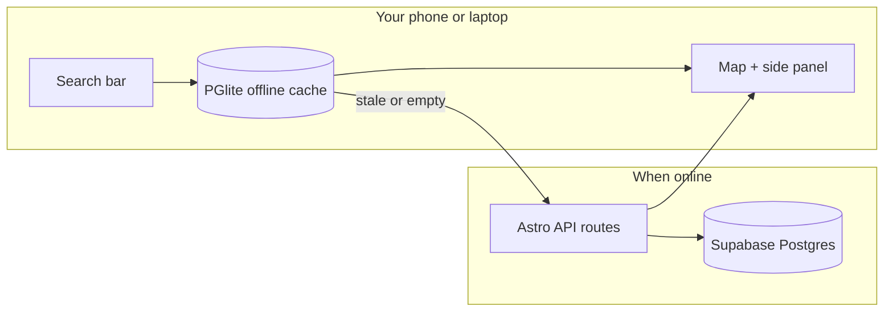
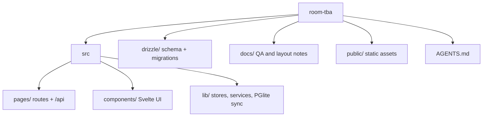

<div align="center">


# Room TBA

**Saan sa UPLB ang \___?**

[](https://room-tba.uplb.tools)
[](LICENSE)
[](https://bun.sh)
[](https://astro.build)
[](https://vercel.com/oss)

_One campus map holds the schedules, buildings, jeepney routes and the answer to "where is PSLH 1?"_

[Open the map](https://room-tba.uplb.tools) | [Wiki](https://room-tba.uplb.tools/wiki) | [FAQ](https://room-tba.uplb.tools/faq) | [Report wrong data](https://github.com/uplbtools/room-tba/issues/new/choose) | [Changelog](https://room-tba.uplb.tools/changelog)

</div>

---

## What this is

**Room TBA** is a map-first web app for [UPLB](https://uplb.edu.ph) students. You search a room code, building nickname or course, and the app puts it on the campus map. It shows schedules when we have them and keeps working when the signal drops.

You don't need an account to browse. Editors and contributors fix data in the same app through a login popup on the map, not a separate admin site.

Under the hood it's a campus platform, not a UPLB-only app. The engine (map UI, search, schedules, offline cache, editor and planner) is kept apart from campus data behind one config file, and independent forks run it at [other universities](#running-at-other-campuses).

## By the numbers

- **58 buildings** and their rooms mapped, searchable, and routable on one campus map
- **94,000+ class sections** imported across **9 academic terms** (AY 2023 to present)
- **50,000+ page views** in the 30 days to late Aug 2026 as the term starts, ~21,000/30d during term break (Vercel Analytics, with peaks in enlistment and exam weeks)
- **20 contributors**, 30+ tagged releases, and a [good-first-issue queue](https://github.com/uplbtools/room-tba/issues?q=is%3Aissue+is%3Aopen+label%3A%22good+first+issue%22) for student developers
- Campus map data published as **open data** under [CC-BY 4.0](https://creativecommons.org/licenses/by/4.0/)
- Serving [UPLB](https://uplb.edu.ph), a campus of roughly 12,000 students, and built to be [forked for other campuses](#fork-this-for-your-campus)
- **Independent campus forks** at UP Visayas, UP Baguio, and Bulacan State University, [all active](#running-at-other-campuses)

> Volunteers update the room and class listings each term. The active term follows the academic calendar (midyear Jun–Jul, 2nd sem Jan–May and so on). **Class search** lists lecture, lab, thesis, special problem and similar sections, and sections without a room in AMIS show as unassigned. **Room schedules** list only lecture and lab sections with assigned rooms. If a schedule is wrong, [open an issue](https://github.com/uplbtools/room-tba/issues/new/choose).

---

## What you can do

| Goal                                | How                                                                                                                                                                                     |
| ----------------------------------- | --------------------------------------------------------------------------------------------------------------------------------------------------------------------------------------- |
| Find **PSLH 1** or **PhySci**       | Search + aliases (`PhySci`, `HUM`, …)                                                                                                                                                   |
| Room schedule this sem              | Term filter + timetable                                                                                                                                                                 |
| Personal schedule route             | Build a plan in Planner → Map tools → Schedule → pick a day, route stops                                                                                                                |
| Browse all classes                  | Status bar → Browse classes, then search by course code                                                                                                                                 |
| Section with no room yet            | "No assigned room" rows hint the offering department and where the course usually meets (#846)                                                                                          |
| Plan your classes                   | Planner view to build a draft schedule                                                                                                                                                  |
| What do I have today                | Today view (`/today`) lists your plan's classes for today, tomorrow and the rest of the week. One tap routes the day on the map with total walking time and distance (`/today?route=1`) |
| Course Planner explainer            | [Four-panel, screenshot-ready guide](https://room-tba.uplb.tools/pubmat/course-planner/)                                                                                                |
| Final exam time & room              | Search a course code for the finals panel, or open the room panel during finals week                                                                                                    |
| Academic calendar                   | [/calendar](https://room-tba.uplb.tools/calendar) shows term windows on a year timeline, and the term picker opens it too                                                               |
| Building location                   | Map, pins, directions, Google Maps                                                                                                                                                      |
| Compare dorm listings               | Verified dorms link to their Kubo listing when available                                                                                                                                |
| Landmarks, services, orgs & offices | Map filters and the App menu, distinct map pins, and shareable detail links                                                                                                             |
| Offline / bad signal                | PWA and local cache, with tiles you already loaded                                                                                                                                      |
| Campus events                       | Events on map with routes                                                                                                                                                               |
| Jeepney routes                      | Route overlays and a printable jeep map from any place, dropped pin or point (right-click or long-press the map)                                                                        |
| Directions from anywhere            | Start from your location, any search result or a dropped pin, and tap the start or end of a trip to change it                                                                           |
| Walking time from a point           | Map tools → Travel time, then tap the map to color paths by minutes                                                                                                                     |
| Measure a route                     | Map tools → Measure route, then drop waypoints for walk, cycle and car times                                                                                                            |
| 3D view                             | Buildings + Makiling terrain (online)                                                                                                                                                   |
| Satellite imagery                   | Map tools → View → Satellite, with locally changed historical imagery back to 2015 when online                                                                                          |
| Common questions                    | [Student FAQ](https://room-tba.uplb.tools/faq) (3D models, data sources, offline)                                                                                                       |
| Tell us something is wrong          | Settings → Feedback (free text, optional contact), or the team on Messenger or Discord                                                                                                  |
| Understand section names            | Wiki guide to the A–H / S–Z class time blocks                                                                                                                                           |
| Find emergency contacts             | Menu → Emergency hotlines, which work offline                                                                                                                                           |
| Check dorm curfew rules             | UP-managed dorm details → Curfew & permits                                                                                                                                              |

<details>
<summary><strong>Editor / contributor mode</strong> (password from the team)</summary>

| Task                                                               | Where                                                                                                                   |
| ------------------------------------------------------------------ | ----------------------------------------------------------------------------------------------------------------------- |
| Move building & dorm pins                                          | Map edit mode (pencil)                                                                                                  |
| Add or correct landmarks, services, organizations, offices & units | **Add something to the map** or the side-panel editor, then pick the map pin                                            |
| Fix room/building/college copy                                     | Side panel → Edit                                                                                                       |
| Suggest edits without publishing                                   | **Suggest an edit** → admin review queue                                                                                |
| Upload event posters                                               | Event editor + R2 image upload (when configured)                                                                        |
| Manage public credit                                               | Account settings → optional HTTPS avatar or profile link, and uncheck credits to opt out                                |
| Undo a pin drag                                                    | Toolbar undo and redo for the session, with durable history in [#202](https://github.com/uplbtools/room-tba/issues/202) |

Log in at **`/?editor=login`** or from the shield or status bar in the app. `/admin` URLs redirect back to the map.

</details>

---

## How a search works



1. On your first visit online, the app syncs buildings, rooms, classes, aliases and events into browser storage.
2. When you search, it reads local data first and goes to the network only when sync keys say something changed.
3. When you pick a result, the map flies to the pin and the side panel shows schedules, directions and a share link.
4. When you go offline, the last sync still answers "saan ang room na 'to?" Map tiles need a prior download or visit.

---

## Stack

- [Astro 7](https://astro.build) + [Svelte 5](https://svelte.dev)
- [Bun](https://bun.sh)
- [Supabase](https://supabase.com) Postgres + [Drizzle](https://orm.drizzle.team) (`drizzle/`)
- [PGlite](https://pglite.dev) in the browser for offline data
- [MapLibre GL](https://maplibre.org), OSM / MapTiler tiles
- [Vercel](https://vercel.com) for SSR and API routes
- Cloudflare R2 for event uploads (optional)

Contributor notes are in [AGENTS.md](AGENTS.md).

---

## Run it locally

### You need

- [Bun](https://bun.sh) 1.3+
- A **Supabase** Postgres URL (`DATABASE_URL`). Use the session pooler for dev.
- `ADMIN_SESSION_SECRET` and an admin account for editor login. Create one with `ADMIN_NEW_PASSWORD='...' bun run scripts/set-admin-user.ts <username>`, since there's no shared admin password.
- `ISR_BYPASS_TOKEN`. It's optional locally and **required on Vercel**, where it revalidates SEO pages after an editor publishes.

### Setup

```sh
git clone https://github.com/uplbtools/room-tba.git
cd room-tba
cp .env.example .env.local
# Fill DATABASE_URL (staging pooler) and ADMIN_SESSION_SECRET. See .env.example for prod and E2E URLs.

bun install
bun dev
```

Open **http://localhost:4321**. Without `DATABASE_URL`, the dev server starts but pages that hit the database return 500, which is expected.

The optional Kubo dorm link loads its directory lazily from Kubo through Room
TBA's cached proxy. The directory starts empty, so no button appears until the
API confirms a matching Room TBA dorm ID. To test **Reserve on Kubo**, **Join
waitlist on Kubo**, **View on Kubo** and an unmapped dorm without Kubo
production access, set `KUBO_ROOM_TBA_DIRECTORY_URL` to a local fixture server.

### Linting and formatting

This project uses [Biome](https://biomejs.dev/) for formatting and linting instead of Prettier and ESLint.

```sh
# Check format and lint without writing
bun run lint

# Fix every safe issue
bun run lint:fix

# Format only
bun run format
```

Install the [Biome VS Code extension](https://marketplace.visualstudio.com/items?itemName=biomejs.biome) to format on save. The workspace settings in `.vscode/settings.json` turn it on.

### Commands

| Command                                              | What it does                                                                                                                                   |
| ---------------------------------------------------- | ---------------------------------------------------------------------------------------------------------------------------------------------- |
| `bun dev`                                            | Dev server                                                                                                                                     |
| `bun run build`                                      | Production build (**needs** `DATABASE_URL`). Entity SEO pages render on first request via Vercel ISR, not at build                             |
| `bun test src/lib src/constants`                     | Unit + store tests (no DB required)                                                                                                            |
| `bun run test:components`                            | Vitest component/layout tests                                                                                                                  |
| `bun run test:integration`                           | API and DB integration on the E2E database (see `docs/testing.md`)                                                                             |
| `bun run e2e`                                        | Playwright blocking suite (`serve:e2e` builds with the node adapter and previews)                                                              |
| `bun run e2e:advisory`                               | Playwright advisory (non-blocking in CI)                                                                                                       |
| `bun run lint`                                       | Biome check (format + lint)                                                                                                                    |
| `bun run lint:fix`                                   | Biome check with auto-fixes                                                                                                                    |
| `bun run format`                                     | Biome format write                                                                                                                             |
| `bunx drizzle-kit studio`                            | Browse/edit Postgres visually                                                                                                                  |
| `bun run seed:aliases`                               | Seed building aliases from `public/room_info.json`                                                                                             |
| `bun scripts/build-walk-graph.ts <graphml>`          | Rebuild `src/generated/walk-graph.json` from an osmnx GraphML export (travel-time tools)                                                       |
| `bun run seed:deep-research`                         | Fill-only data-gap seed from the 2026-07 research report (`DATABASE_URL`, supports `--dry-run`)                                                |
| `bun run generate:pglite-schema`                     | Regenerate the offline PGlite init SQL from `drizzle/schema.ts`                                                                                |
| `bun run import:osa-orgs`                            | Add the current public OSA organization directory (`DATABASE_URL`, safe to rerun)                                                              |
| `bun run import:campus-offices`                      | Add missing campus offices and units (`DATABASE_URL`, safe to rerun)                                                                           |
| `bun run import:amis-classes`                        | Upsert AMIS classes (`docs/amis-com-refresh-runbook.md`)                                                                                       |
| `bun run backfill:acad-orgs`                         | Rerun the AMIS import over the 9 cached term JSONs to fill `classes.acad_group`/`acad_org` (#846)                                              |
| `bun run import:final-exams`                         | Import OUR finals JSON into Postgres (`DATABASE_URL`, see `docs/final-exams-data-source.md`)                                                   |
| `bun run audit:campus-data`                          | Read-only sweep for wrong pins, scattered tenants, missing building links and orphan rooms (`PROD_DATABASE_URL`, writes nothing)               |
| `bun run apply:campus-audit-links -- --prod --apply` | Apply the verified organization-to-building links from the campus audit, with `editor_history` records                                         |
| `bun run record:bulk-history`                        | Record `editor_history` rows for a maintenance/bulk data operation (`DATABASE_URL`, dry run unless `--apply`, see `docs/bulk-data-history.md`) |
| `bun run backfill:bulk-history`                      | One-off history backfill for the 2026-08-03/04 direct-database corrections (`DATABASE_URL`, dry run unless `--apply`)                          |

The legacy **`data/info.db`** SQLite file is only for old seed and export scripts (`bun:sqlite`), not the runtime. Production uses Supabase Postgres via `DATABASE_URL`. Archived SQLite migrations live in `drizzle-migrations/` and shouldn't be edited. The active schema is in `drizzle/`.

Optional env vars (R2 uploads, Supabase Auth client) are in [`.env.example`](.env.example). Set `PUBLIC_APP_ENV=staging` on Vercel Preview and in local dev. Production uses `production` (the default) and hides the staging banner.

---

## Repo map



The editor QA plan is [`docs/editor-foundation-test-plan.md`](docs/editor-foundation-test-plan.md) and the PR checklist is [`docs/agentic-qa-process.md`](docs/agentic-qa-process.md).

---

## Contributing

**[CONTRIBUTING.md](CONTRIBUTING.md)** explains how to help.

- You can **report wrong data** or do **campus QA** without a clone or a PR.
- To **write code**, branch off `staging` and open the PR to `staging` ([developer guide](docs/developer-guide.md)).
- **Maintainers and agents** start at [AGENTS.md](AGENTS.md) and [agent tooling](docs/agent-tooling.md), and run `bun run install:agent-tooling` and `install:agent-plugins` once per machine.

Start with the [good first issues](https://github.com/uplbtools/room-tba/issues?q=is%3Aissue+is%3Aopen+label%3A%22good+first+issue%22). Data issues carry the `data` label and QA issues carry `qa`. You can chat with the team on [Messenger](https://room-tba.uplb.tools/messenger/contribute).

Before you implement something, read the [issue hygiene](docs/issue-hygiene.md) notes and the [PR QA process](docs/agentic-qa-process.md).

---

## Releases

Versions follow semver. Pushes to `main` run [semantic-release](https://semantic-release.gitbook.io/) (skip with `[skip ci]` in the commit message). The in-app status bar shows `vX.Y.Z` from `package.json`.

`bun run release:dry` does a dry run.

---

## Credits

**Founder and lead:** [Simonee Ezekiel Mariquit](https://stimmie.dev)

**Core team**

| Person                                            | Works on                                 |
| ------------------------------------------------- | ---------------------------------------- |
| [Ken Ramiscal](https://kendan.dev)                | Offline support, map, interface          |
| Eunice Almeyda                                    | Directions, map chrome, mobile interface |
| [Simeon Ricalde](https://meonnn.github.io/)       | Publicity and outreach                   |
| [Kalinaw Lukas Aom Bebis](https://lukasbebis.com) | Interface, map, bug fixes                |

**Design:** [Rovic Villaralvo](https://rovicdesign.framer.website/) · Mary Gwyneth Telmosa (interface design)

**Also contributed:** Niño Anthony Marmeto (Electrical Engineering building info) · Rosh Almario (Institute of Chemistry room directions) · everyone on the [contributors graph](https://github.com/uplbtools/room-tba/graphs/contributors)

Team page: [uplb.tools/people](https://www.uplb.tools/people) · Press kit: [uplb.tools/press](https://www.uplb.tools/press)

Org: [uplbtools](https://github.com/uplbtools) · Campus tool, not an official UPLB product.

---

## Sponsors

Room TBA is funded by campus-relevant sponsors we pick and by one-time donations. Revenue covers running costs first (hosting, database, domains, promotion), including paying back maintainers for costs they paid themselves. The rest funds contributor payouts and core team incentives. Every peso is tracked in public transparency reports.

**[Donate](https://room-tba.uplb.tools/donate)** | **[Become a sponsor](https://room-tba.uplb.tools/sponsors)** | [Funding model](docs/funding-model.md) | [Ad policy](docs/ad-policy.md)

### Transparency policy

- Donations are anonymous by default. The app stores only the amount and an optional message, never donor identity. Donors who want public credit can ask on Discord or Messenger.
- We publish a transparency report (totals received, itemized expenses, payout status, running balance) instead of raw transaction slips, which carry donor and account details.
- We keep the original PayMongo and GCash records privately as the audit trail, and redacted copies are available on request. Expense receipts (hosting, domain) may be published with personal details cropped.
- Contributor payouts go out through GCash and QR Ph, by points as the [funding model](docs/funding-model.md) sets.

---

## Fork this for your campus

MIT lets you fork this and run it for a different school. It isn't a "swap the logo and ship" fork, because a lot of the app is UPLB data and UPLB-specific glue. You keep the engine (map UI, search, offline cache, editor, planner, the Drizzle schema) and replace the UPLB parts.

### Running at other campuses

Each of these forks is maintained by its own campus.

| Campus                             | Fork                                                                                                                                  |
| ---------------------------------- | ------------------------------------------------------------------------------------------------------------------------------------- |
| UP Visayas                         | [andrianllmm/upv-room-tba](https://github.com/andrianllmm/upv-room-tba)                                                               |
| UP Baguio                          | [UPB-Tools/room-tba](https://github.com/UPB-Tools/room-tba)                                                                           |
| Bulacan State University (Malolos) | [bulsutools/room-tba](https://github.com/bulsutools/room-tba), live at [bulsu-room-tba.vercel.app](https://bulsu-room-tba.vercel.app) |
| UP Diliman                         | [uplbtools/room-tba-upd](https://github.com/uplbtools/room-tba-upd) (our own port, in progress)                                       |

The full guide, with every file path and the painful parts, is **[Fork this for your campus](https://room-tba.uplb.tools/wiki/fork-for-your-campus)** in the wiki. For the config file, start with the **[fork wizard](https://room-tba.uplb.tools/fork)**. You point a map at your campus and it generates `src/campus.config.ts` and a Vercel deploy link.

You can also run `bun run fork:init`. It asks for your campus name, URL, map center, bounds and zoom, and whether you want the 3D terrain and transit overlays, then rewrites `src/campus.config.ts`. It refuses a dirty git tree unless you pass `--force`.

To see it working first, run `bun run seed:sample`. It loads a small fictional campus (6 buildings, 12 rooms, 2 terms of classes) into an empty database, so the app runs before you have any real data. `bun run import:classes-generic -- your-classes.csv` imports your registrar's export from a documented flat CSV or JSON shape. [docs/fork-data-guide.md](docs/fork-data-guide.md) walks through both.

This table lists what you replace.

| File                                           | What to change                                                                                                                                                                                                                                                                                                  |
| ---------------------------------------------- | --------------------------------------------------------------------------------------------------------------------------------------------------------------------------------------------------------------------------------------------------------------------------------------------------------------- |
| `src/campus.config.ts`                         | **The single config file** (`bun run fork:init` writes it). Site name, URL, title, description, map center/bounds/camera, terrain (`campusTerrain.enabled` off = flat map), transit overlay (`campusTransit.enabled` + menu label), E2E fixture coordinates, community links. The files below import from here. |
| `public/room_info.json`                        | UPLB building seed → your buildings                                                                                                                                                                                                                                                                             |
| `src/constants/jeepney-routes.ts` + geometries | Your transit routes/stops, or set `campusTransit.enabled: false` to hide the overlay everywhere                                                                                                                                                                                                                 |
| `src/generated/walk-graph.json`                | UPLB path network (travel-time tools). Rebuild it from your campus's OSM extract with `bun scripts/build-walk-graph.ts <your-osmnx-export.graphml>`. Speeds are in `src/constants/travel-modes.ts`.                                                                                                             |
| `scripts/import-amis-classes.ts` and friends   | UPLB data sources (AMIS, OUR finals, OSA). Use `bun run import:classes-generic` with your registrar's export instead ([guide](docs/fork-data-guide.md)).                                                                                                                                                        |
| Supabase DB contents                           | Every row is UPLB. The schema stays and the data goes.                                                                                                                                                                                                                                                          |

The hard part is class schedules. Room TBA pulls from AMIS, which is UPLB's system. You don't have AMIS, so flatten whatever your registrar gives you into the generic importer's CSV/JSON shape ([docs/fork-data-guide.md](docs/fork-data-guide.md)) and rerun it each term. `data/sample-campus/classes.csv` is the worked example.

After you think you've replaced everything, run `bun run fork:check`. It scans for hardcoded UPLB strings you missed and reports file:line hits. Wire it into your fork's CI so a stray UPLB string doesn't sneak back in on a merge from upstream.

---

## License

| Layer                                                                    | License                                                                                                       |
| ------------------------------------------------------------------------ | ------------------------------------------------------------------------------------------------------------- |
| Application code                                                         | [MIT](LICENSE)                                                                                                |
| Community campus map data (buildings, rooms, dorms, orgs, pins, aliases) | [CC-BY 4.0](https://creativecommons.org/licenses/by/4.0/)                                                     |
| OpenStreetMap basemap / footprints                                       | [ODbL](https://www.openstreetmap.org/copyright) (+ [MapTiler](https://www.maptiler.com/copyright/) for tiles) |
| AMIS/CRS, OUR, OSA imports                                               | Not offered under an open bulk license                                                                        |

Use the code, fork it, teach with it. If you deploy a fork for another campus, change the data, not just the logo. See the [fork guide](#fork-this-for-your-campus) above. The student-facing summary is [Can I reuse Room TBA data?](https://room-tba.uplb.tools/faq#data-license) in the FAQ.

---

<div align="center">

**[room-tba.uplb.tools](https://room-tba.uplb.tools)**

</div>
